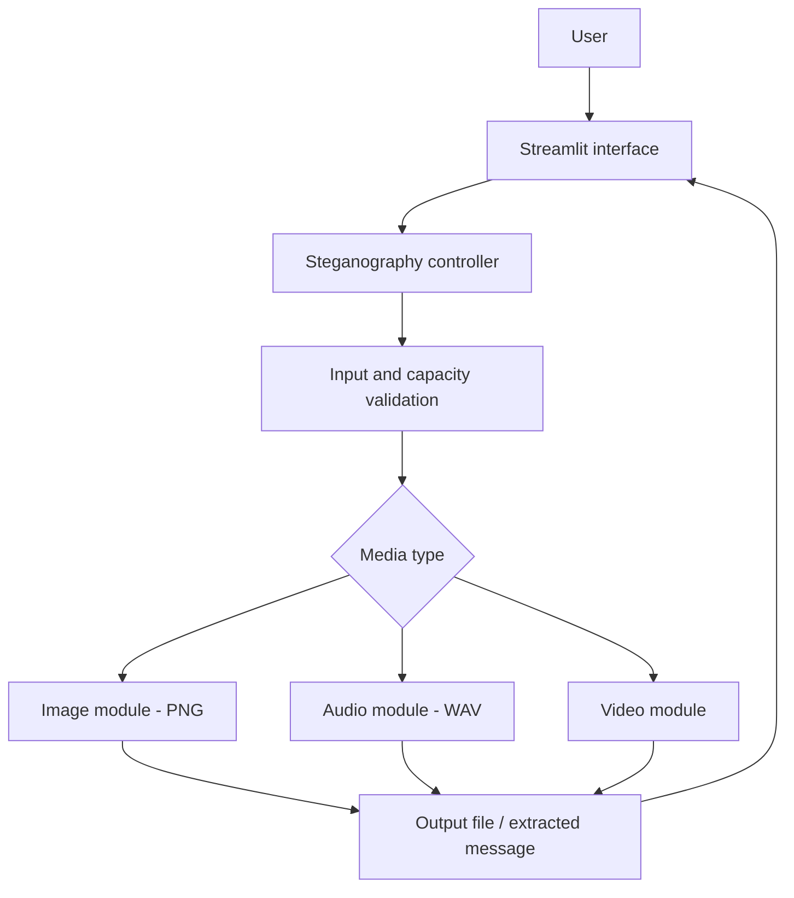
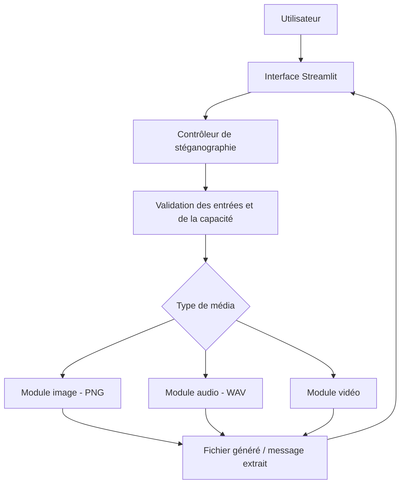

# EFREIGMA

> **🇫🇷 Version française en bas ↓** — [Accéder directement à la version française](#-version-française)

<div align="center">

**Efreigma**

*A steganography engine -  Efrei Cybersecurity & Ethical Hacking project*


</div>

---

## 🇬🇧 English version

### 🔎 About the project

**Efreigma** combines **Efrei** and **Enigma**. It is a cybersecurity project focused on designing and implementing a **steganography engine** that can hide and extract secret information in common media formats, including **images, audio, and video**.

Unlike cryptography, which makes information unreadable, **steganography aims to conceal its very presence**. The goal is to explore this principle through a working application and evaluate its technical limitations.

> **Project scope:** the course brief requires an engine supporting several media formats. The technical choices and implementation plan below are *proposals*, not requirements imposed by the school.

### 🚀 Functional V1 — installation and demonstration

**V1 implemented:** a standalone PNG LSB engine and a local classroom-inspired cartoon Streamlit interface.
Hide and extract exact UTF-8 text (accents, emojis and line breaks), inspect capacity
in bytes, preview images, download the resulting PNG, and copy/download recovered
text. RGB/RGBA dimensions and RGBA alpha are preserved. Extraction needs only the
saved PNG, including after restarting the application.

**Prerequisites:** Python 3.11+ and Git. Run from the repository root. The current
runtime dependencies are Pillow and Streamlit; Pytest is used for verification.
Audio uses the Python standard library. Video uses PyAV, included in the installation command.

Clone this repository using its GitHub URL, or open an existing checkout, then:

```powershell
python -m venv .venv
.\.venv\Scripts\python.exe -m pip install -r requirements.txt
.\.venv\Scripts\streamlit.exe run app.py
.\.venv\Scripts\python.exe -m pytest -q
```

On macOS/Linux, replace the executable paths with `.venv/bin/python` and
`.venv/bin/streamlit`. After activating the environment, the equivalent commands
are `python -m pip install -r requirements.txt`, `streamlit run app.py` and
`python -m pytest -q`. Open http://127.0.0.1:8501.

**Demo:** a generated, non-sensitive carrier is available at `examples/demo.png` (86,359 payload bytes). In “Hide a message”, upload a PNG, enter `Été à Efrei 🔐`, inspect the
UTF-8 byte counter, click “Cacher le message”, then “Télécharger le PNG”. In
“Extract a message”, upload that downloaded PNG and click “Extraire”. Use the
copy icon or download the exact UTF-8 text. Do not resize or convert the image.

**Python API** (after installation):

```python
from pathlib import Path
from efreigma import get_capacity, hide_message, extract_message

source = Path("examples/demo.png").read_bytes()
print(get_capacity(source))  # UTF-8 bytes, after the 41-byte header
Path("secret.png").write_bytes(hide_message(source, "Été à Efrei 🔐"))
assert extract_message(Path("secret.png").read_bytes()) == "Été à Efrei 🔐"
```

**Limits:** static 8-bit RGB/RGBA PNG only; 20 MiB per file and 4 million pixels.
RGB transparency via `tRNS` is unsupported: use RGBA.
Empty text, oversized payloads, unsupported images and invalid/altered hidden
messages are rejected. Metadata is discarded; use RGBA for transparency. SHA-256
checks integrity, without encryption or authentication. LSB can be detected and
pixel edits or lossy compression can destroy the message.

The implemented structure is `app.py`, `src/efreigma/steganography/image_lsb.py`,
`src/efreigma/utils/validators.py`, `src/efreigma/exceptions.py`, `tests/`,
`docs/architecture.md`, `requirements.txt`, `pyproject.toml` and `.streamlit/config.toml`.
See [the architecture and EFR1 binary format](docs/architecture.md).

**Next versions:** optional encryption and further quality/performance
evaluation. The V1 implementation does not complete the seven individual academic
reports; their tracking below is preserved.

### 🎵 PNG + WAV update — three classroom pages

The app now has three direct routes, all using the same colorful classroom design:

- `/home`: choose the image or audio workshop; `/` redirects here.
- `/image`: the existing PNG workflow.
- `/audio`: upload, listen, inspect capacity, hide/extract UTF-8 text and download WAV/text.

Open http://127.0.0.1:8501/home after running `streamlit run app.py`.
Use the provided `examples/demo.wav` for a quick demonstration: upload it in the
audio workshop, enter a message, hide it and download the resulting WAV. Reimport
that downloaded file under “Extract a message” to retrieve the exact text.

Supported audio: **little-endian RIFF WAV, integer PCM, mono/stereo, 8/16/24/32 bits**,
up to 192 kHz and 20 MiB. MP3, compressed WAV, float PCM and WAVE_FORMAT_EXTENSIBLE
are rejected. One bit is stored in the least significant bit of each channel sample;
8-bit PCM can be more audibly affected, so 16-bit or higher is preferable.
The output preserves channel count, sample rate, bit depth, duration and other chunks.
Capacity is `max(0, floor(frame_count × channel_count / 8) − 41)` UTF-8 bytes.

```python
from pathlib import Path
from efreigma import get_audio_capacity, hide_audio_message, extract_audio_message

source = Path("examples/demo.wav").read_bytes()
print(get_audio_capacity(source))
Path("secret.wav").write_bytes(hide_audio_message(source, "Un petit mot dans le son 🔐"))
assert extract_audio_message(Path("secret.wav").read_bytes()) == "Un petit mot dans le son 🔐"
```

Keep the downloaded WAV unchanged: conversion to MP3, volume changes, resampling
and editing can erase the payload. No encryption is provided. No additional runtime
dependency is required. Tests: `python -m pytest -q`.

### 🎬 Video workshop — /video

A third cartoon workshop is available from `/home` and at
http://127.0.0.1:8501/video. Upload a short MP4, MOV, AVI, WebM or MKV, inspect
its UTF-8 capacity, hide a message and download the **lossless FFV1 MKV**.
Reimport that MKV to recover and copy/download the exact text. Use
`examples/demo.mp4` (two seconds, with audio) for the demonstration.

The browser plays an optional **silent MP4 preview**. The hidden message lives
in the downloaded MKV; the MP4 preview must not be used for extraction.
Decoded RGB dimensions, frame count and timing are preserved, and a supported
audio track is remuxed without re-encoding. Conversion is to RGB8; orientation,
HDR, alpha and original metadata are not guaranteed.

Limits: 20 MiB input/output, 30 seconds, 600 frames, 2 million pixels/frame,
30 million decoded pixels overall and up to 60 frames/s. One video track and
at most one supported audio track; subtitles and extra tracks are rejected.
The output may be larger than the input because it is lossless.

Install/update with `python -m pip install -r requirements.txt`.
PyAV 17 is included; no separate FFmpeg executable is required for the tested
Windows wheel. Run `streamlit run app.py` and `python -m pytest -q` as before.

```python
from pathlib import Path
from efreigma import get_video_capacity, hide_video_message, extract_video_message

source = Path("examples/demo.mp4").read_bytes()
print(get_video_capacity(source))
Path("secret.mkv").write_bytes(hide_video_message(source, "Un secret dans le film 🔐"))
assert extract_video_message(Path("secret.mkv").read_bytes()) == "Un secret dans le film 🔐"
```

[Video architecture, supported codecs and limits](docs/video.md).
Lossy conversion, resizing or editing can destroy the message. No encryption is provided.

### 🎯 Objectives

- Embed a secret message inside a supported carrier file.
- Extract the hidden message without losing its contents.
- Support image, audio, and video media progressively.
- Compare capacity, quality impact, performance, and robustness.
- Document the architecture, implementation, testing, and backups.

### 🧩 Planned features

| Feature | Description | Status |
| --- | --- | :---: |
| Image steganography | Hide/recover UTF-8 messages in RGB/RGBA PNG images | ✅ V1 |
| Audio steganography | Hide/recover UTF-8 messages in integer PCM WAV | ✅ Available |
| Video steganography | Import clips, hide/recover text through lossless FFV1 MKV | ✅ Available |
| Local web interface | Upload, preview, embed/extract, copy and download | ✅ V1 |
| Validation and testing | Capacity, SHA-256 integrity, limits and automated tests | ✅ V1 |
| Optional encryption | Encrypt the message before embedding | 💡 Optional |

### 🛠️ Proposed technology stack

| Component | Technology | Purpose |
| --- | :---: | --- |
| Language | Python | Core steganography engine |
| Interface | Streamlit | Local web interface |
| Images | Pillow | Pixel manipulation |
| Audio | Python standard library (`struct`, `wave` for tests) | PCM WAV sample manipulation |
| Video | PyAV / FFmpeg codecs | RGB frame processing, FFV1 encoding and MP4 previews |
| Tests | Pytest | Automated validation |
| Version control | Git / GitHub | Source tracking and backup |

### 🏗️ Proposed architecture



**Illustrative embedding workflow:**

```text
Carrier file + secret message
             ↓
       Input validation
             ↓
      Embedding module
             ↓
       Stego media file
             ↓
 Extraction module → Recovered message
```

**Initial algorithm idea:** Least Significant Bit (LSB) substitution for lossless image and WAV prototypes. Video requires particular care because lossy compression can destroy embedded information.

### 📦 Deliverables tracker

**Progress: 0/7 prepared**

> The seven deliverable categories below come from the *Projets Fil rouge* presentation. The descriptions are practical interpretations for Efreigma.

- [ ] **1. Activity report and cost/budget tracking**  
  Describe team organization, completed tasks, schedule, time spent, resources, and budget monitoring.
- [ ] **2. Preliminary project study (MOA)**  
  Define needs, objectives, target users, expected features, constraints, and success criteria.
- [ ] **3. Technology watch report (in English)**  
  Review existing steganography techniques, algorithms, tools, performance, limitations, and references.
- [ ] **4. Technical architecture dossier (MOE)**  
  Describe the architecture, language, libraries, image/audio/video modules, algorithms, and component interactions.
- [ ] **5. Implementation report**  
  Document the work completed, main functions, screenshots, test results, issues, and fixes.
- [ ] **6. Architecture improvement report**  
  Explain the initial design's limitations and improvements in performance, reliability, security, concealment quality, and modularity.
- [ ] **7. Backup plan**  
  Explain how source code, configurations, test files, and documentation are backed up and restored.

**Submission rules:** the project is completed in groups of **3–4 students** throughout the year; **deliverables must be individual**, with submission through the anonymization tool on **Moodle**.

**Deadlines:** no precise submission dates are specified in the provided presentation; check Moodle or ask the instructor.

### 🗺️ Suggested roadmap

1. **Research & requirements** — scope the project and prepare the MOA and English technology watch.
2. **Technical design** — define modules, data formats, and architecture (MOE).
3. **Image MVP** — implement PNG embedding and extraction with tests.
4. **Additional media** — extend the engine to WAV and video.
5. **User interface** — integrate modules into Streamlit.
6. **Evaluation & improvements** — test quality, limits, failures, and resilience.
7. **Documentation & delivery** — finalize reports, backup procedure, and demonstration.

### 📁 Suggested repository structure

```text
efreigma/
├── app/                  # Streamlit interface (planned)
├── src/
│   └── efreigma/
│       ├── image/         # Image module
│       ├── audio/         # Audio module
│       └── video/         # Video module
├── tests/                # Automated tests
├── docs/                 # Project reports and architecture
├── examples/             # Non-sensitive sample files
├── requirements.txt      # Dependencies (to be defined)
└── README.md
```

> This tree is a **proposed structure**; it does not assert that these files or modules already exist.

### 🔐 Security and limitations

- Steganography **does not inherently encrypt** a message.
- Lossy re-encoding, resizing, or file conversions may remove hidden data.
- Simple LSB approaches can be detected through statistical analysis.
- Validate file formats, size, payload capacity, and extraction errors.
- Use test data only and do not commit real secrets to the repository.

### 📚 Academic context

**School:** Efrei  
**Program:** Bachelor Cybersecurity & Ethical Hacking (B3)  
**Project:** *Projet 5 — Développement d’un moteur de stéganographie*  
**Source:** *Projets Fil rouge* presentation

---

## 🇫🇷 Version française

### 🔎 Présentation du projet

**Efreigma** associe **Efrei** et **Enigma**. C'est un projet de cybersécurité consacré à la conception et au développement d'un **moteur de stéganographie** permettant de cacher et d'extraire des informations secrètes dans plusieurs formats courants : **image, audio et vidéo**.

Contrairement à la cryptographie, qui rend l'information illisible, **la stéganographie cherche à dissimuler l'existence même du message**. Le projet vise à mettre ce principe en pratique et à en étudier les limites techniques.

> **Périmètre :** le sujet pédagogique demande un moteur compatible avec plusieurs formats. Les choix techniques et le plan de réalisation ci-dessous sont des *propositions*, et non des obligations fixées par l'école.

### 🚀 V1 fonctionnelle — installation et démonstration

**V1 implémentée :** moteur LSB PNG indépendant et interface locale Streamlit cartoon inspirée d’une salle de classe.
Elle permet de cacher et d’extraire exactement un texte UTF-8 (accents, emojis et
retours à la ligne), de consulter la capacité en octets, de prévisualiser les images,
de télécharger le PNG, puis de copier ou télécharger le texte extrait. Les dimensions
RGB/RGBA et l’alpha RGBA sont conservés. L’extraction utilise uniquement le PNG
sauvegardé et fonctionne après redémarrage de l’application.

**Prérequis :** Python 3.11+ et Git. Ouvrir le dépôt cloné et lancer les commandes
ci-dessous depuis sa racine. Les dépendances de la V1 sont Pillow et Streamlit,
avec Pytest pour les tests. L’audio utilise la bibliothèque standard Python. La vidéo utilise PyAV, inclus dans la commande d’installation.

```powershell
python -m venv .venv
.\.venv\Scripts\python.exe -m pip install -r requirements.txt
.\.venv\Scripts\streamlit.exe run app.py
.\.venv\Scripts\python.exe -m pytest -q
```

Sous macOS/Linux, utiliser `.venv/bin/python` et `.venv/bin/streamlit`. Avec
l’environnement activé : `python -m pip install -r requirements.txt`,
`streamlit run app.py` et `python -m pytest -q`. Ouvrir http://127.0.0.1:8501.

**Démonstration :** l’image générée `examples/demo.png` est fournie sans données sensibles (86 359 octets utiles). Dans « Hide a message », importer un PNG, saisir `Été à Efrei 🔐`,
vérifier le compteur d’octets UTF-8, cliquer sur « Cacher le message », puis sur
« Télécharger le PNG ». Réimporter le fichier téléchargé dans « Extract a message »
et cliquer sur « Extraire ». L’icône de copie et le téléchargement texte permettent
de récupérer le message. Ne pas redimensionner ou convertir l’image.

**API Python** (après installation) :

```python
from pathlib import Path
from efreigma import get_capacity, hide_message, extract_message

source = Path("examples/demo.png").read_bytes()
print(get_capacity(source))  # Octets UTF-8, en-tête de 41 octets déduit
Path("secret.png").write_bytes(hide_message(source, "Été à Efrei 🔐"))
assert extract_message(Path("secret.png").read_bytes()) == "Été à Efrei 🔐"
```

**Limites :** PNG statiques RGB/RGBA 8 bits, 20 Mio par fichier et 4 millions de
pixels. La transparence RGB `tRNS` est refusée : utiliser RGBA.
Texte vide, capacité dépassée, images non prises en charge et messages
invalides/altérés sont refusés. Les métadonnées ne sont pas conservées ; utiliser
RGBA pour la transparence. SHA-256 vérifie l’intégrité sans chiffrer ni authentifier
le message. Le LSB est détectable et une modification des pixels ou une compression
avec perte peut détruire les données.

La structure implémentée comprend `app.py`, `src/efreigma/steganography/image_lsb.py`,
`src/efreigma/utils/validators.py`, `src/efreigma/exceptions.py`, `tests/`,
`docs/architecture.md`, `requirements.txt`, `pyproject.toml` et `.streamlit/config.toml`.
Voir [l’architecture et le format binaire EFR1](docs/architecture.md).

**Prochaines versions :** chiffrement facultatif et évaluation approfondie
de la qualité et des performances. L’implémentation V1 ne vaut pas remise des sept
rapports académiques individuels ; leur suivi est conservé ci-dessous.

### 🎵 Extension PNG + WAV — trois pages de classe

L’application dispose de trois routes directes dans le même style cartoon coloré :

- `/home` : choisir l’atelier image ou audio ; `/` redirige vers cette page.
- `/image` : le parcours PNG existant.
- `/audio` : importer, écouter, consulter la capacité, cacher/extraire du texte UTF-8 et télécharger le WAV/texte.

Ouvrir http://127.0.0.1:8501/home après `streamlit run app.py`.
Le fichier `examples/demo.wav` est fourni : l’importer dans l’atelier audio,
saisir un message, le dissimuler et télécharger le WAV. Réimporter ce fichier
dans « Extract a message » pour récupérer exactement le texte.

Audio pris en charge : **RIFF WAV little-endian, PCM entier, mono/stéréo,
8/16/24/32 bits**, jusqu’à 192 kHz et 20 Mio. MP3, WAV compressé, PCM flottant
et WAVE_FORMAT_EXTENSIBLE sont refusés. Un bit est inséré dans le bit de poids faible
de chaque échantillon de canal ; le PCM 8 bits peut être davantage audible,
privilégier 16 bits ou plus. Le nombre de canaux, la fréquence, la profondeur,
la durée et les autres blocs du fichier sont conservés.
Capacité : `max(0, floor(nombre_de_trames × nombre_de_canaux / 8) − 41)` octets UTF-8.

```python
from pathlib import Path
from efreigma import get_audio_capacity, hide_audio_message, extract_audio_message

source = Path("examples/demo.wav").read_bytes()
print(get_audio_capacity(source))
Path("secret.wav").write_bytes(hide_audio_message(source, "Un petit mot dans le son 🔐"))
assert extract_audio_message(Path("secret.wav").read_bytes()) == "Un petit mot dans le son 🔐"
```

Conserver le WAV téléchargé sans modification : conversion MP3, changement de
volume, rééchantillonnage et montage peuvent effacer le message. Aucun chiffrement
n’est fourni. Aucune dépendance supplémentaire n’est nécessaire.
Tests : `python -m pytest -q`.

### 🎬 Atelier vidéo — /video

Un troisième atelier cartoon est disponible depuis `/home` et sur
http://127.0.0.1:8501/video. Importer un court MP4, MOV, AVI, WebM ou MKV,
consulter sa capacité UTF-8, cacher un message et télécharger le **MKV FFV1 sans perte**.
Réimporter ce MKV pour récupérer exactement le texte et le copier/télécharger.
Le fichier `examples/demo.mp4` est fourni (deux secondes, avec du son).

Le navigateur lit un **aperçu MP4 muet** à la demande. Le message est dans le
MKV téléchargé ; l’aperçu MP4 ne doit pas servir à l’extraction.
Les dimensions RGB décodées, le nombre d’images et les horodatages sont conservés.
Une piste audio prise en charge est copiée sans réencodage. La conversion se fait
vers RGB8 ; orientation, HDR, alpha et métadonnées d’origine ne sont pas garantis.

Limites : 20 Mio en entrée/sortie, 30 secondes, 600 images, 2 millions de pixels/image,
30 millions de pixels décodés au total et 60 images/s maximum. Une piste vidéo
et au plus une piste audio compatible ; sous-titres et pistes supplémentaires refusés.
La sortie sans perte peut être plus volumineuse que l’entrée.

Installer/mettre à jour avec `python -m pip install -r requirements.txt`.
PyAV 17 est inclus ; aucun exécutable FFmpeg séparé n’est nécessaire avec la roue
Windows testée. Lancement : `streamlit run app.py`. Tests : `python -m pytest -q`.

```python
from pathlib import Path
from efreigma import get_video_capacity, hide_video_message, extract_video_message

source = Path("examples/demo.mp4").read_bytes()
print(get_video_capacity(source))
Path("secret.mkv").write_bytes(hide_video_message(source, "Un secret dans le film 🔐"))
assert extract_video_message(Path("secret.mkv").read_bytes()) == "Un secret dans le film 🔐"
```

[Architecture vidéo, codecs et limites](docs/video.md).
Conversion avec perte, redimensionnement et montage peuvent détruire le message.
Aucun chiffrement n’est fourni.

### 🎯 Objectifs

- Dissimuler un message secret dans un fichier support.
- Extraire le message sans perte de contenu.
- Prendre progressivement en charge les images, l'audio et la vidéo.
- Comparer la capacité, l'altération, les performances et la robustesse.
- Documenter l'architecture, le développement, les tests et la sauvegarde.

### 🧩 Fonctionnalités envisagées

| Fonctionnalité | Description | État |
| --- | --- | :---: |
| Stéganographie d'image | Cacher/récupérer du texte UTF-8 dans des PNG RGB/RGBA | ✅ V1 |
| Stéganographie audio | Cacher/récupérer du texte UTF-8 dans des WAV PCM entiers | ✅ Disponible |
| Stéganographie vidéo | Importer des clips, cacher/récupérer du texte dans des MKV FFV1 | ✅ Disponible |
| Interface web locale | Importer, prévisualiser, cacher/extraire, copier et télécharger | ✅ V1 |
| Validation et tests | Capacité, intégrité SHA-256, limites et tests automatisés | ✅ V1 |
| Chiffrement facultatif | Chiffrer le message avant son insertion | 💡 Optionnel |

### 🛠️ Technologies envisagées

| Composant | Technologie | Utilisation |
| --- | :---: | --- |
| Langage | Python | Développement du moteur |
| Interface | Streamlit | Interface web locale |
| Images | Pillow | Manipulation des pixels |
| Audio | Bibliothèque standard Python (`struct`, `wave` pour les tests) | Manipulation des échantillons WAV PCM |
| Vidéo | PyAV / codecs FFmpeg | Images RGB, encodage FFV1 et aperçus MP4 |
| Tests | Pytest | Validation des fonctions |
| Versionnement | Git / GitHub | Gestion du code et sauvegarde |

### 🏗️ Architecture proposée



**Exemple de parcours de dissimulation :**

```text
Fichier support + message secret
               ↓
      Validation des entrées
               ↓
        Module d'insertion
               ↓
       Fichier stéganographié
               ↓
 Module d'extraction → Message récupéré
```

**Première piste algorithmique :** la substitution des bits de poids faible (*LSB*) sur les images sans perte et les fichiers WAV. Pour la vidéo, une compression avec perte peut détruire les données cachées.

### 📦 Suivi des livrables

**Progression : 0/7 préparés**

> Les sept catégories de livrables proviennent du support *Projets Fil rouge*. Les détails ci-dessous sont adaptés au projet Efreigma.

- [ ] **1. Compte rendu d’activité et pilotage des coûts**  
  Présenter l'organisation de l'équipe, les tâches effectuées, le planning, le temps passé, les ressources utilisées et le suivi du budget.
- [ ] **2. Étude d’avant-projet (MOA)**  
  Expliquer le besoin, les objectifs, les utilisateurs, les fonctionnalités attendues, les contraintes et les critères de réussite du moteur de stéganographie.
- [ ] **3. Rapport de veille en anglais**  
  Étudier en anglais les techniques de stéganographie existantes, les algorithmes, les outils, leurs performances et leurs limites. Ajouter les sources.
- [ ] **4. Dossier d’architecture technique (MOE)**  
  Décrire l'architecture retenue, le langage, les bibliothèques, les modules image/audio/vidéo, les algorithmes et les échanges entre composants.
- [ ] **5. Compte rendu des travaux d’implémentation**  
  Présenter le développement réalisé, les principales fonctions, les captures, les résultats des tests, les problèmes rencontrés et leurs corrections.
- [ ] **6. Compte rendu de l’amélioration de l’architecture**  
  Montrer les limites de la première version et les améliorations apportées : performances, fiabilité, sécurité, qualité de la dissimulation, modularité.
- [ ] **7. Description du plan de sauvegarde**  
  Expliquer comment sauvegarder le code source, les configurations, les fichiers de test et la documentation, puis comment les restaurer.

**Modalités de rendu :** projet réalisé **sur l'année en groupes de 3 ou 4 étudiants** ; les **livrables sont individualisés** et remis via l'outil d'anonymisation sur **Moodle**.

**Dates de rendu :** aucune date précise n'est indiquée dans la présentation fournie. Consulter Moodle ou demander au professeur.

### 🗺️ Feuille de route proposée

1. **Recherche et cadrage** — étude des besoins, MOA et veille en anglais.
2. **Conception technique** — architecture, modules et formats (MOE).
3. **Premier prototype image** — insertion et extraction dans des PNG, avec tests.
4. **Extension multimédia** — ajout du WAV et de la vidéo.
5. **Interface utilisateur** — intégration des modules dans Streamlit.
6. **Tests et améliorations** — mesure de la qualité, des limites et des performances.
7. **Documentation et rendu** — rapports, procédure de sauvegarde et démonstration.

### 📁 Organisation envisagée du dépôt

```text
efreigma/
├── app/                  # Interface Streamlit (prévue)
├── src/
│   └── efreigma/
│       ├── image/         # Module image
│       ├── audio/         # Module audio
│       └── video/         # Module vidéo
├── tests/                # Tests automatisés
├── docs/                 # Livrables et schémas techniques
├── examples/             # Fichiers de démonstration non sensibles
├── requirements.txt      # Dépendances (à préciser)
└── README.md
```

> Cette arborescence est **indicative** : elle ne signifie pas que les modules sont déjà développés.

### 🔐 Sécurité et limites

- La stéganographie **ne chiffre pas automatiquement** les messages.
- Le redimensionnement, la conversion ou la compression avec perte peuvent effacer les données cachées.
- Les méthodes LSB simples peuvent être repérées par analyse statistique.
- Vérifier les formats, la taille des fichiers, la capacité et les erreurs d'extraction.
- Utiliser des données de test et ne jamais publier de secrets réels dans le dépôt.

### 📚 Contexte pédagogique

**École :** Efrei  
**Formation :** Bachelor Cybersécurité & Ethical Hacking (B3)  
**Sujet :** *Projet 5 — Développement d’un moteur de stéganographie*  
**Référence :** présentation *Projets Fil rouge*

---
