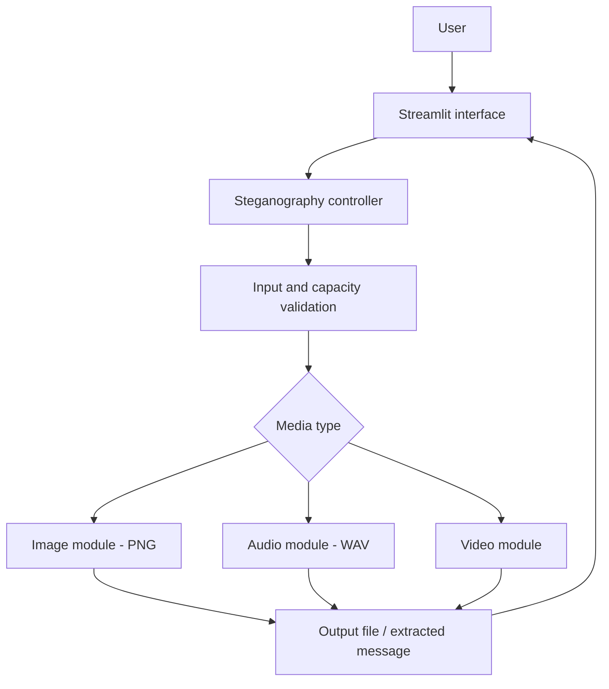
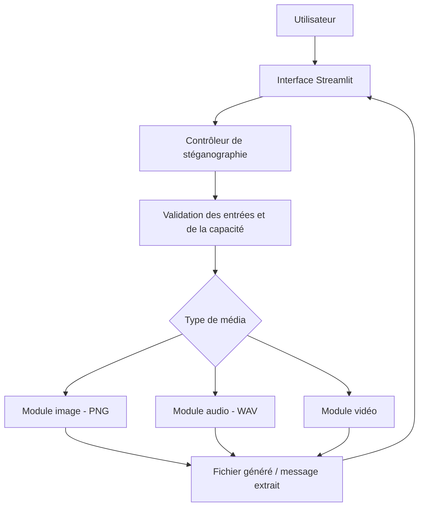

# EFREIGMA

> **🇫🇷 Version française en bas ↓** — [Accéder directement à la version française](#-version-française)

<div align="center">

**Efreigma**

*A steganography engine -  Efrei Cybersecurity & Ethical Hacking project*


</div>

---

## 🇬🇧 English version

### 🔎 About the project

**Efreigma** combines **Efrei** and **Enigma**. It is a cybersecurity project focused on designing and implementing a **steganography engine** that can hide and extract secret information in common media formats, including **images, audio, and video**.

Unlike cryptography, which makes information unreadable, **steganography aims to conceal its very presence**. The goal is to explore this principle through a working application and evaluate its technical limitations.

> **Project scope:** the course brief requires an engine supporting several media formats. The technical choices and implementation plan below are *proposals*, not requirements imposed by the school.

### 🎯 Objectives

- Embed a secret message inside a supported carrier file.
- Extract the hidden message without losing its contents.
- Support image, audio, and video media progressively.
- Compare capacity, quality impact, performance, and robustness.
- Document the architecture, implementation, testing, and backups.

### 🧩 Planned features

| Feature | Description | Status |
| --- | --- | :---: |
| Image steganography | Hide/recover messages in lossless PNG images | 📋 Planned |
| Audio steganography | Hide/recover messages in WAV files | 📋 Planned |
| Video steganography | Hide/recover messages in suitable video formats | 📋 Planned |
| Local web interface | Upload a carrier, embed or extract a message | 📋 Planned |
| Validation and testing | Capacity checks, integrity checks, automated tests | 📋 Planned |
| Optional encryption | Encrypt the message before embedding | 💡 Optional |

### 🛠️ Proposed technology stack

| Component | Technology | Purpose |
| --- | :---: | --- |
| Language | Python | Core steganography engine |
| Interface | Streamlit | Local web interface |
| Images | Pillow | Pixel manipulation |
| Audio | `wave` / NumPy | WAV sample manipulation |
| Video | OpenCV / FFmpeg | Video frame processing |
| Tests | Pytest | Automated validation |
| Version control | Git / GitHub | Source tracking and backup |

### 🏗️ Proposed architecture



**Illustrative embedding workflow:**

```text
Carrier file + secret message
             ↓
       Input validation
             ↓
      Embedding module
             ↓
       Stego media file
             ↓
 Extraction module → Recovered message
```

**Initial algorithm idea:** Least Significant Bit (LSB) substitution for lossless image and WAV prototypes. Video requires particular care because lossy compression can destroy embedded information.

### 📦 Deliverables tracker

**Progress: 0/7 prepared**

> The seven deliverable categories below come from the *Projets Fil rouge* presentation. The descriptions are practical interpretations for Efreigma.

- [ ] **1. Activity report and cost/budget tracking**  
  Describe team organization, completed tasks, schedule, time spent, resources, and budget monitoring.
- [ ] **2. Preliminary project study (MOA)**  
  Define needs, objectives, target users, expected features, constraints, and success criteria.
- [ ] **3. Technology watch report (in English)**  
  Review existing steganography techniques, algorithms, tools, performance, limitations, and references.
- [ ] **4. Technical architecture dossier (MOE)**  
  Describe the architecture, language, libraries, image/audio/video modules, algorithms, and component interactions.
- [ ] **5. Implementation report**  
  Document the work completed, main functions, screenshots, test results, issues, and fixes.
- [ ] **6. Architecture improvement report**  
  Explain the initial design's limitations and improvements in performance, reliability, security, concealment quality, and modularity.
- [ ] **7. Backup plan**  
  Explain how source code, configurations, test files, and documentation are backed up and restored.

**Submission rules:** the project is completed in groups of **3–4 students** throughout the year; **deliverables must be individual**, with submission through the anonymization tool on **Moodle**.

**Deadlines:** no precise submission dates are specified in the provided presentation; check Moodle or ask the instructor.

### 🗺️ Suggested roadmap

1. **Research & requirements** — scope the project and prepare the MOA and English technology watch.
2. **Technical design** — define modules, data formats, and architecture (MOE).
3. **Image MVP** — implement PNG embedding and extraction with tests.
4. **Additional media** — extend the engine to WAV and video.
5. **User interface** — integrate modules into Streamlit.
6. **Evaluation & improvements** — test quality, limits, failures, and resilience.
7. **Documentation & delivery** — finalize reports, backup procedure, and demonstration.

### 📁 Suggested repository structure

```text
efreigma/
├── app/                  # Streamlit interface (planned)
├── src/
│   └── efreigma/
│       ├── image/         # Image module
│       ├── audio/         # Audio module
│       └── video/         # Video module
├── tests/                # Automated tests
├── docs/                 # Project reports and architecture
├── examples/             # Non-sensitive sample files
├── requirements.txt      # Dependencies (to be defined)
└── README.md
```

> This tree is a **proposed structure**; it does not assert that these files or modules already exist.

### 🔐 Security and limitations

- Steganography **does not inherently encrypt** a message.
- Lossy re-encoding, resizing, or file conversions may remove hidden data.
- Simple LSB approaches can be detected through statistical analysis.
- Validate file formats, size, payload capacity, and extraction errors.
- Use test data only and do not commit real secrets to the repository.

### 📚 Academic context

**School:** Efrei  
**Program:** Bachelor Cybersecurity & Ethical Hacking (B3)  
**Project:** *Projet 5 — Développement d’un moteur de stéganographie*  
**Source:** *Projets Fil rouge* presentation

---

## 🇫🇷 Version française

### 🔎 Présentation du projet

**Efreigma** associe **Efrei** et **Enigma**. C'est un projet de cybersécurité consacré à la conception et au développement d'un **moteur de stéganographie** permettant de cacher et d'extraire des informations secrètes dans plusieurs formats courants : **image, audio et vidéo**.

Contrairement à la cryptographie, qui rend l'information illisible, **la stéganographie cherche à dissimuler l'existence même du message**. Le projet vise à mettre ce principe en pratique et à en étudier les limites techniques.

> **Périmètre :** le sujet pédagogique demande un moteur compatible avec plusieurs formats. Les choix techniques et le plan de réalisation ci-dessous sont des *propositions*, et non des obligations fixées par l'école.

### 🎯 Objectifs

- Dissimuler un message secret dans un fichier support.
- Extraire le message sans perte de contenu.
- Prendre progressivement en charge les images, l'audio et la vidéo.
- Comparer la capacité, l'altération, les performances et la robustesse.
- Documenter l'architecture, le développement, les tests et la sauvegarde.

### 🧩 Fonctionnalités envisagées

| Fonctionnalité | Description | État |
| --- | --- | :---: |
| Stéganographie d'image | Cacher/récupérer des messages dans des PNG sans perte | 📋 Prévu |
| Stéganographie audio | Cacher/récupérer des messages dans des WAV | 📋 Prévu |
| Stéganographie vidéo | Cacher/récupérer des messages dans des vidéos adaptées | 📋 Prévu |
| Interface web locale | Charger un fichier, dissimuler ou extraire un message | 📋 Prévu |
| Validation et tests | Contrôles de capacité, intégrité, tests automatisés | 📋 Prévu |
| Chiffrement facultatif | Chiffrer le message avant son insertion | 💡 Optionnel |

### 🛠️ Technologies envisagées

| Composant | Technologie | Utilisation |
| --- | :---: | --- |
| Langage | Python | Développement du moteur |
| Interface | Streamlit | Interface web locale |
| Images | Pillow | Manipulation des pixels |
| Audio | `wave` / NumPy | Manipulation des échantillons WAV |
| Vidéo | OpenCV / FFmpeg | Traitement des images vidéo |
| Tests | Pytest | Validation des fonctions |
| Versionnement | Git / GitHub | Gestion du code et sauvegarde |

### 🏗️ Architecture proposée



**Exemple de parcours de dissimulation :**

```text
Fichier support + message secret
               ↓
      Validation des entrées
               ↓
        Module d'insertion
               ↓
       Fichier stéganographié
               ↓
 Module d'extraction → Message récupéré
```

**Première piste algorithmique :** la substitution des bits de poids faible (*LSB*) sur les images sans perte et les fichiers WAV. Pour la vidéo, une compression avec perte peut détruire les données cachées.

### 📦 Suivi des livrables

**Progression : 0/7 préparés**

> Les sept catégories de livrables proviennent du support *Projets Fil rouge*. Les détails ci-dessous sont adaptés au projet Efreigma.

- [ ] **1. Compte rendu d’activité et pilotage des coûts**  
  Présenter l'organisation de l'équipe, les tâches effectuées, le planning, le temps passé, les ressources utilisées et le suivi du budget.
- [ ] **2. Étude d’avant-projet (MOA)**  
  Expliquer le besoin, les objectifs, les utilisateurs, les fonctionnalités attendues, les contraintes et les critères de réussite du moteur de stéganographie.
- [ ] **3. Rapport de veille en anglais**  
  Étudier en anglais les techniques de stéganographie existantes, les algorithmes, les outils, leurs performances et leurs limites. Ajouter les sources.
- [ ] **4. Dossier d’architecture technique (MOE)**  
  Décrire l'architecture retenue, le langage, les bibliothèques, les modules image/audio/vidéo, les algorithmes et les échanges entre composants.
- [ ] **5. Compte rendu des travaux d’implémentation**  
  Présenter le développement réalisé, les principales fonctions, les captures, les résultats des tests, les problèmes rencontrés et leurs corrections.
- [ ] **6. Compte rendu de l’amélioration de l’architecture**  
  Montrer les limites de la première version et les améliorations apportées : performances, fiabilité, sécurité, qualité de la dissimulation, modularité.
- [ ] **7. Description du plan de sauvegarde**  
  Expliquer comment sauvegarder le code source, les configurations, les fichiers de test et la documentation, puis comment les restaurer.

**Modalités de rendu :** projet réalisé **sur l'année en groupes de 3 ou 4 étudiants** ; les **livrables sont individualisés** et remis via l'outil d'anonymisation sur **Moodle**.

**Dates de rendu :** aucune date précise n'est indiquée dans la présentation fournie. Consulter Moodle ou demander au professeur.

### 🗺️ Feuille de route proposée

1. **Recherche et cadrage** — étude des besoins, MOA et veille en anglais.
2. **Conception technique** — architecture, modules et formats (MOE).
3. **Premier prototype image** — insertion et extraction dans des PNG, avec tests.
4. **Extension multimédia** — ajout du WAV et de la vidéo.
5. **Interface utilisateur** — intégration des modules dans Streamlit.
6. **Tests et améliorations** — mesure de la qualité, des limites et des performances.
7. **Documentation et rendu** — rapports, procédure de sauvegarde et démonstration.

### 📁 Organisation envisagée du dépôt

```text
efreigma/
├── app/                  # Interface Streamlit (prévue)
├── src/
│   └── efreigma/
│       ├── image/         # Module image
│       ├── audio/         # Module audio
│       └── video/         # Module vidéo
├── tests/                # Tests automatisés
├── docs/                 # Livrables et schémas techniques
├── examples/             # Fichiers de démonstration non sensibles
├── requirements.txt      # Dépendances (à préciser)
└── README.md
```

> Cette arborescence est **indicative** : elle ne signifie pas que les modules sont déjà développés.

### 🔐 Sécurité et limites

- La stéganographie **ne chiffre pas automatiquement** les messages.
- Le redimensionnement, la conversion ou la compression avec perte peuvent effacer les données cachées.
- Les méthodes LSB simples peuvent être repérées par analyse statistique.
- Vérifier les formats, la taille des fichiers, la capacité et les erreurs d'extraction.
- Utiliser des données de test et ne jamais publier de secrets réels dans le dépôt.

### 📚 Contexte pédagogique

**École :** Efrei  
**Formation :** Bachelor Cybersécurité & Ethical Hacking (B3)  
**Sujet :** *Projet 5 — Développement d’un moteur de stéganographie*  
**Référence :** présentation *Projets Fil rouge*

---
