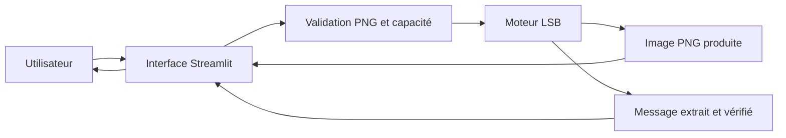

# Efreigma V1 — architecture et format PNG

## Périmètre

Python 3.11+, Pillow, Streamlit et Pytest. Le moteur image traite des PNG
statiques RGB/RGBA 8 bits. L’extension actuelle ajoute le WAV PCM et les pages
`/home`, `/image`, `/audio` et `/video` ; voir [l’architecture audio](audio.md)
et [l’architecture vidéo](video.md). Le chiffrement reste à développer.
Le moteur est indépendant de Streamlit ; aucun service, compte ou stockage externe
n’est nécessaire. L’interface est servie sur `127.0.0.1` par défaut.



## Organisation

- `app.py` : navigation et cadre commun ; `views/` : accueil et ateliers image/audio.
- `src/efreigma/ui/` : présentation commune, importation, aperçu/écoute, capacité,
  actions, copie et téléchargements.
- `assets/classroom.css` : cahier crème, intercalaires colorés, contours cartoon et
  adaptation aux petits écrans ; illustration SVG intégrée à l’interface, sans ressource externe.
- `src/efreigma/__init__.py` : API publique.
- `steganography/image_lsb.py` : insertion et extraction PNG.
- `steganography/audio_lsb.py` : insertion et extraction WAV PCM.
- `steganography/video_lsb.py` : insertion RGB LSB, sortie MKV FFV1 et aperçu MP4.
- `utils/video_validators.py` : validation des pistes et budgets de décodage/encodage.
- `steganography/payload.py` : format EFR1 partagé, SHA-256 et UTF-8.
- `utils/audio_validators.py` : contrôle des WAV et offsets des échantillons.
- `utils/validators.py` : format réel, intégrité PNG, modes, taille et encodage.
- `exceptions.py` : `EfreigmaError` et erreurs spécialisées, sans contenu secret.
- `tests/` : images générées par Pillow, erreurs, limites, nouveau processus et
  parcours Streamlit via AppTest. Aucun téléchargement nécessaire.
- `.streamlit/config.toml` : thème clair, limite d’importation, accès local.

Les entrées et les sorties sont des `bytes`. Les PNG passent par `BytesIO`, sans
fichier temporaire. L’interface conserve les résultats en session pour afficher les
boutons de téléchargement ; elle les invalide quand les entrées changent. Seul le
PNG téléchargé est nécessaire à l’extraction ultérieure. Il faut le télécharger
avant de fermer l’application. Les secrets ne sont pas journalisés.

## API

```python
from efreigma import hide_message, extract_message, get_capacity, EfreigmaError

capacity: int = get_capacity(png_bytes)
stego_png: bytes = hide_message(png_bytes, "Été à Efrei 🔐")
text: str = extract_message(stego_png)
```

Les trois fonctions valident les images et lèvent `InvalidImageError` si nécessaire.
`hide_message` lève `InvalidMessageError` pour le texte vide, invalide ou trop grand.
`extract_message` lève `InvalidPayloadError` pour un en-tête ou message invalide.
Ces exceptions dérivent de `EfreigmaError`, lui-même dérivé de `ValueError`.
Les espaces, retours à la ligne, caractères nuls et séquences Unicode sont conservés
exactement, sans normalisation. Le message vide est refusé.

## Format binaire EFR1

| Position en octets | Taille | Contenu |
| --- | ---: | --- |
| 0 | 4 | Signature ASCII `EFR1` |
| 4 | 1 | Version non signée : `1` |
| 5 | 4 | Longueur du texte UTF-8, entier non signé big-endian |
| 9 | 32 | SHA-256 des octets du texte |
| 41 | longueur | Texte encodé en UTF-8 |

L’en-tête fait **41 octets** (`struct.Struct(">4sBI32s")`). Chaque octet est inséré
du bit le plus significatif au moins significatif. Les pixels suivent l’ordre des
lignes de haut en bas, de gauche à droite, avec les canaux **R, G, B** dans cet ordre.
Un canal contient un bit. L’alpha n’est jamais utilisé ni modifié.

Pour une image de largeur W et hauteur H :

```text
octets disponibles = floor(W × H × 3 / 8)
capacité utile = max(0, octets disponibles − 41)
```

Les bits restants et canaux inutilisés sont laissés intacts. Une image ne pouvant
contenir un en-tête complet a une capacité de zéro ; aucun message ne peut y être
inséré. Le nombre de caractères n’est pas le nombre d’octets UTF-8.

À l’extraction, le moteur lit d’abord seulement l’en-tête, vérifie la signature et la
version, puis vérifie la longueur avant toute allocation du message. Il extrait
exactement cette longueur, compare SHA-256, puis décode strictement UTF-8. Les octets
restants de l’image ne font pas partie du message.

## Validation et mémoire

- Maximum **20 Mio** de données PNG compressées, contrôlé avant ouverture.
- Maximum **4 000 000 pixels**, contrôlé avant décodage des pixels.
- Vérification des structures/checksums PNG par Pillow, puis décodage complet.
- Modes palette, gris, 16 bits et PNG animés refusés explicitement. Les PNG RGB
  avec transparence `tRNS` sont refusés : utiliser un PNG RGBA pour préserver l’alpha.
- Les alertes de décompression de Pillow deviennent des erreurs contrôlées sans
  modifier ses paramètres globaux ni ignorer ses protections.
- Aucun tableau de millions d’objets représentant les bits : l’insertion parcourt
  les octets et modifie un `bytearray`, l’extraction utilise un itérateur.

Les limites s’appliquent aussi aux appels directs à l’API. Le traitement est linéaire
par rapport aux pixels décodés et aux bits du message. Plusieurs copies bornées du
buffer de pixels existent pendant l’opération ; les 4 millions de pixels limitent
cette consommation. Les limites ne constituent pas une garantie de mémoire maximale
pour plusieurs utilisateurs simultanés : la V1 est destinée à une démonstration locale.

## Conservation et limites

Les dimensions, le mode RGB/RGBA et tous les échantillons alpha RGBA restent identiques.
Chaque canal RGB varie d’au plus 1 sur 255. Les sorties sont toujours des PNG.
Les métadonnées ne sont pas recopiées (EXIF, profils ICC, commentaires, etc.).
Pour conserver une transparence, utiliser un vrai PNG **RGBA**.

SHA-256 détecte une altération accidentelle ; il n’est ni un chiffrement ni une
authentification. Une personne connaissant le format peut lire et remplacer le
message en recalculant l’empreinte. Le LSB peut être détecté par analyse statistique.
Redimensionner, recomprimer avec pertes, convertir en JPEG ou modifier les pixels
peut détruire le message. La conservation d’un PNG sans modification est essentielle.

## Évolutions

Les moteurs WAV et vidéo ont rejoint `steganography/` sans dépendre de l’interface.
Un chiffrement exigera un format versionné, une gestion de clés
et de nouveaux tests. Les livrables académiques individuels restent distincts des
fichiers techniques présents dans ce dépôt.

## Vérification de la V1

Validation exécutée le **12 octobre 2026**, sous Windows avec Python **3.13.1**,
Pillow **12.3.0**, Streamlit **1.65.0** et Pytest **9.1.1** :

- `python -m pytest -q` : **64 tests réussis**, sans avertissement (2,79 s).
- `python -m pip check` : aucune incompatibilité de dépendances.
- `streamlit run app.py --server.headless true` : serveur local démarré ;
  `/_stcore/health` répond **HTTP 200**, `ok`.
- Dans le navigateur : importation de `examples/demo.png`, dissimulation de
  `Été à Efrei 🔐` suivi d’un retour à la ligne et de `Démonstration V1.`,
  téléchargement du PNG, réimportation et extraction du texte exact avec succès.
- Les tests AppTest couvrent aussi l’extraction dans une nouvelle session ; un
  test du moteur réouvre le PNG dans un nouveau processus avec Streamlit interdit.

Les tests AppTest simulent les importations ; le parcours dans le navigateur
complète cette vérification avec une importation et un téléchargement réels.
Python 3.11 est déclaré comme minimum, mais l’exécution a été vérifiée sur 3.13.1.
