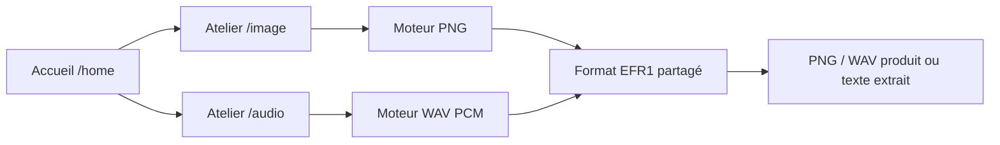

# Atelier audio — WAV PCM et navigation

## Pages

`app.py` déclare les routes Streamlit avec `st.navigation` et `st.Page`.
La racine redirige vers `/home`. Les fichiers `views/home.py`, `views/image.py`
et `views/audio.py` correspondent aux routes `/home`, `/image` et `/audio`.
Ils partagent l’en-tête, le menu, le pied de page, la feuille de style et les
illustrations SVG locales. Les liens Streamlit fonctionnent sans serveur supplémentaire.

`src/efreigma/ui/layout.py` gère le cadre de classe et `ui/workshop.py` le parcours
commun importation → aperçu/écoute → capacité → dissimulation/extraction → téléchargement.
Les clés de widgets et résultats audio sont distinctes de celles des images.
Modifier l’entrée invalide le résultat ; changer de page efface les résultats affichés
pour éviter de présenter un fichier ou texte issu d’un autre atelier.

## API et format

```python
from efreigma import hide_audio_message, extract_audio_message, get_audio_capacity

capacity: int = get_audio_capacity(wav_bytes)
encoded: bytes = hide_audio_message(wav_bytes, "Été à Efrei 🔐")
message: str = extract_audio_message(encoded)
```

`InvalidAudioError`, dérivée de `EfreigmaError`, signale les erreurs de fichier.
Les erreurs de texte et de message caché utilisent les mêmes exceptions que le PNG.
Le moteur ne dépend pas de Streamlit. Il utilise seulement la bibliothèque standard.

Le format EFR1 est partagé dans `steganography/payload.py` : signature `EFR1`,
version 1, longueur UTF-8 non signée sur 4 octets big-endian, SHA-256 de 32 octets,
puis texte UTF-8. Les PNG existants restent compatibles. L’en-tête fait 41 octets.

Le WAV est PCM little-endian : le bit de poids faible d’un échantillon est dans
son **premier octet**. Un seul bit est écrit par échantillon, même en 16/24/32 bits.
Les canaux sont entrelacés : gauche puis droite pour chaque trame stéréo.
Les octets EFR1 sont parcourus du bit le plus significatif au moins significatif.
Le bloc `data` est le seul bloc modifié, et tous les bits autres que les LSB ciblés
restent intacts. Les LSB inutilisés restent aussi identiques.

```text
échantillons = nombre_de_trames × nombre_de_canaux
capacité = max(0, floor(échantillons / 8) − 41) octets UTF-8
```

L’amplitude entière change d’au plus 1, sans changement de durée, fréquence,
canaux ou profondeur. Le PCM 8 bits est moins discret que les profondeurs supérieures.
La V1 ne prétend pas que ce procédé est indétectable ou toujours inaudible.

## Validation

- Au plus 20 Mio, avant analyse et allocation d’un buffer de sortie.
- RIFF/WAVE little-endian, taille RIFF correspondant exactement au fichier.
- Chaque bloc est borné et son éventuel octet de bourrage est vérifié par sa présence.
  Le dernier bloc `data` impair peut omettre le bourrage, comme le fait `wave` en Python.
- Un bloc `fmt` avant un unique bloc `data` ; blocs annexes préservés octet pour octet.
- PCM entier (`wFormatTag = 1`), mono ou stéréo, 8/16/24/32 bits, 1 à 192 000 Hz.
- Débit et alignement cohérents ; données non vides composées de trames complètes.
- Refus des MP3, RF64/RIFX, WAV compressés, PCM flottants et formats extensibles.
- Longueur EFR1 vérifiée avant extraction, puis contrôle SHA-256 et UTF-8 strict.

L’entrée reste immuable. L’insertion travaille dans un `bytearray` puis retourne des
`bytes` ; aucun fichier temporaire ni transcodage n’est requis. Les 20 Mio bornent
la taille du fichier, mais plusieurs buffers existent pendant l’opération.

## Limites et démonstration

Ce procédé ne chiffre pas et n’authentifie pas le texte. Modifier le volume,
rééchantillonner, convertir en MP3 ou monter le son peut effacer le message.
Télécharger et conserver le WAV produit avant fermeture de l’application.

`examples/demo.wav` contient trois notes générées localement, sans message caché.
Les tests créent également leurs propres WAV avec `wave`, sans ressource externe.



## Vérification de l’extension

Le 12 octobre 2026, sous Python 3.13.1 : `python -m pytest -q` donne
**131 tests réussis**, sans avertissement (3,76 s). Cela inclut les tests PNG,
les profondeurs PCM 8/16/24/32 bits en mono et stéréo, les données altérées,
les erreurs WAV, la réouverture dans un nouveau processus sans Streamlit,
les parcours AppTest et la navigation entre ateliers.

Dans le navigateur, les liens `/home`, `/image` et `/audio` ont été vérifiés.
Le WAV de démonstration a été importé, un texte Unicode inséré, le WAV téléchargé,
puis la page rechargée et le fichier réimporté : le texte exact a été extrait.
