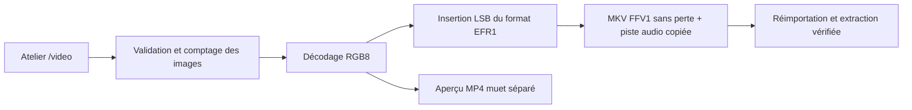

# Atelier vidéo — RGB LSB et MKV FFV1

## Pages et utilisation

L’accueil `/home` propose maintenant trois ateliers : `/image`, `/audio` et `/video`.
`views/video.py` utilise le cadre de classe commun et `ui/video_workshop.py` fournit
l’importation, la capacité UTF-8, les aperçus, la dissimulation, l’extraction et les téléchargements.
Les résultats et aperçus vidéo sont isolés de ceux des autres ateliers et invalidés
quand les entrées changent ou que l’on change de page.

Importer `examples/demo.mp4`, saisir un texte, cliquer sur « Cacher le message »,
puis télécharger **efreigma-secret.mkv**. Dans « Extract a message », réimporter
ce MKV et cliquer sur « Extraire ». Le texte peut être copié ou téléchargé en UTF-8.

## Installation

```powershell
.\.venv\Scripts\python.exe -m pip install -r requirements.txt
.\.venv\Scripts\streamlit.exe run app.py
.\.venv\Scripts\python.exe -m pytest -q
```

PyAV (`av>=17,<18`) fournit l’accès aux codecs FFmpeg. L’environnement de validation
utilise la roue Windows PyAV 17.1.0 ; aucun exécutable `ffmpeg` séparé n’est nécessaire.
Pillow sert à manipuler les pixels RGB. Aucun fichier temporaire n’est créé.

## API

```python
from pathlib import Path
from efreigma import get_video_capacity, hide_video_message, extract_video_message

source = Path("examples/demo.mp4").read_bytes()
print(get_video_capacity(source))
encoded = hide_video_message(source, "Un secret dans le film 🔐")
Path("secret.mkv").write_bytes(encoded)
assert extract_video_message(Path("secret.mkv").read_bytes()) == "Un secret dans le film 🔐"
```

`get_video_info` et `get_video_preview` sont disponibles dans
`efreigma.steganography.video_lsb`. `InvalidVideoError`, dérivée de `EfreigmaError`,
signale les fichiers non pris en charge, les erreurs de décodage et les limites.
Les erreurs de texte et de message caché utilisent les exceptions partagées.
Le moteur ne dépend pas de Streamlit.

## Algorithme et conservation

Les images sont décodées vers **RGB 8 bits**, puis parcourues dans leur ordre de
présentation. Pour chaque image, les pixels suivent l’ordre des lignes, canaux
R puis G puis B. Un bit est stocké par canal. Les octets EFR1 sont parcourus du bit
le plus significatif au moins significatif, sans remplissage entre les images.
L’en-tête et le texte peuvent donc traverser plusieurs images vidéo.

Le format partagé reste `EFR1 | version 1 | longueur UTF-8 (4 octets big-endian) |
SHA-256 (32 octets) | texte UTF-8`. L’en-tête fait 41 octets.

```text
capacité = max(0, floor(largeur × hauteur × nombre_d’images_décodées × 3 / 8) − 41)
```

L’insertion modifie chaque canal d’au plus 1 par rapport aux **pixels RGB décodés**
de l’entrée. La sortie est un **Matroska MKV, codec FFV1, format de pixels bgr0**.
Ce codage sans perte préserve exactement les pixels porteurs à la réouverture.
Les dimensions, le nombre d’images et les horodatages sont conservés, avec la
précision temporelle du conteneur Matroska (tolérance de 2 ms dans les tests).
Les horodatages négatifs de l’amorçage AAC sont conservés, sans décaler la vidéo.

Une piste audio prise en charge est copiée par remuxage, sans réencodage : les
octets de ses paquets et leur synchronisation sont conservés. Les métadonnées
globales, chapitres, orientation et profils couleur ne sont pas garantis. L’alpha,
le HDR et la profondeur source supérieure à 8 bits ne sont pas conservés : la
sortie est RGB8. Utiliser des clips SDR déjà orientés pour une démonstration fidèle.

## Aperçu navigateur

FFV1 MKV n’est pas un format de lecture natif courant dans les navigateurs.
Le bouton « Lire l’aperçu vidéo (muet) » génère un proxy **MP4 H.264 muet** en mémoire,
uniquement à la demande. Ses dimensions peuvent être ajustées d’un pixel si elles
sont impaires pour permettre le yuv420p. Ce proxy est compressé avec perte : il
ne sert jamais à l’extraction et ne remplace pas le MKV téléchargé.
Le son reste dans le MKV, même si l’aperçu est muet.

## Validation et limites

- Entrées MP4/MOV, AVI, WebM ou MKV, selon les codecs décodables par PyAV.
- Une seule piste vidéo, au plus une piste audio ; sous-titres, pièces jointes et
  autres pistes sont refusés pour éviter de les perdre silencieusement.
- Audio accepté : AAC, MP3, Opus, Vorbis, FLAC et PCM s16le/s24le/s32le/f32le.
- **20 Mio** maximum en entrée et en sortie. Une sortie sans perte peut grossir ;
  un buffer borné interrompt aussi l’encodage si la limite est atteinte.
- **30 secondes**, **600 images**, **2 millions de pixels/image** et
  **30 millions de pixels décodés au total**, cadence connue de 0,1 à 60 images/s.
- Résolution fixe et horodatages présents et croissants.
- La capacité provient d’un décodage complet et du nombre réel d’images ; les
  limites sont contrôlées avant et pendant le décodage. Une image est traitée à la fois.
- L’extraction exige FFV1 RGB et contrôle signature, version, longueur, SHA-256 et UTF-8.

Ces limites conviennent à une démonstration locale. Le traitement peut prendre
plusieurs secondes. Les décodeurs peuvent récupérer certains conteneurs partiellement
endommagés ; SHA-256 vérifie le message extrait, pas l’intégrité de toute la vidéo.

Le LSB reste détectable et ne chiffre pas le texte. Convertir le MKV en MP4,
redimensionner, recadrer, monter ou recomprimer peut détruire le message.

## Références techniques

- [PyAV — conversions de VideoFrame](https://pyav.org/docs/stable/api/video.html)
- [PyAV — tests officiels d’encodage FFV1 bgr0 et de remuxage](https://github.com/PyAV-Org/PyAV/blob/master/tests/test_encode.py)



## Vérification effectuée

Le 12 octobre 2026, Windows / Python 3.13.1 / PyAV 17.1.0 :

- `python -m pytest -q` : **169 tests réussis**, sans avertissement, en 7,42 s.
- `python -m pip check` : aucune incompatibilité de dépendances.
- Tests vidéo : ASCII/Unicode, message sur plusieurs images, capacité exacte,
  pixels à ±1, conservation des horodatages, paquets audio PCM et AAC identiques,
  signature/version/intégrité altérées, limites, aperçu H.264 et extraction dans
  un nouveau processus sans Streamlit.
- AppTest : aperçu, dissimulation, téléchargement disponible, nouvelle session
  d’extraction, erreurs et invalidation des anciens résultats.
- Navigateur : lien depuis `/home` vers `/video`, importation de `demo.mp4`, insertion
  du texte `Un secret dans le film 🔐` puis d’un retour à la ligne et de `Été à Efrei.`,
  téléchargement MKV, rechargement et réimportation : texte exact récupéré.
- L’aperçu navigateur chargé indique **320 × 180**, **2 s**, sans erreur de lecture.

La démonstration MP4 fait 26 401 octets ; sa capacité est de 518 359 octets UTF-8.
Le MKV du test de démonstration fait 239 557 octets : l’augmentation de taille est
attendue avec un encodage sans perte.
